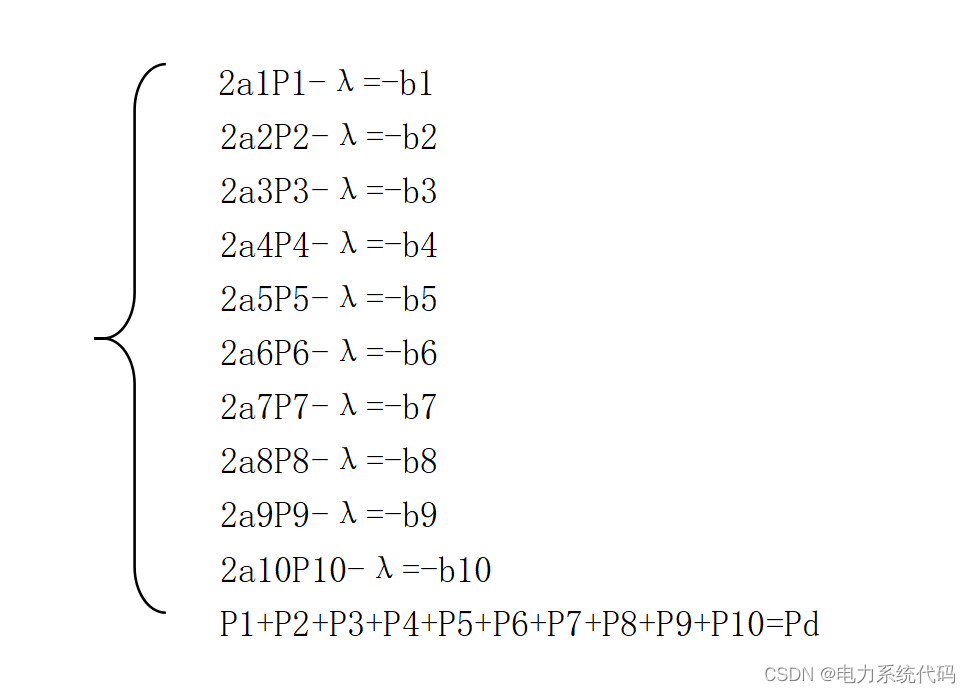

# MATLLB|Power System Optimization Operation and Marketization

​  
Contents
1. Distribution of power plant load according to the principle of small increase in equivalent consumption rate
1.1 Example
1.2 Principle
1.3 Programming Thoughts
II. Load Allocation Based on Equal Pricing Strategy
2.1 Examples
2.2 Principles
2.3 Programming Thoughts
3. MATLAB Code Implementation
Editor
1. Distribution of power plant load according to the principle of equalized consumption rate
Table 1: Unit consumption characteristics and related parameters of power plants
Unit
a  
b  
c  
Pmin/MW  
Pmax/MW  
1  
0.000786  
0.27  
8.00  
30  
100  
2  
0.000792  
0.3  
5.0  
20  
80  
3  
0.000764  
0.28  
6.4  
25  
120  
4  
0.000270  
0.2657  
20  
50  
150  
5  
0.000424  
0.308  
5.8  
50  
150  
6  
0.001020  
0.28  
3.0  
15  
60  
7  
0.000578  
0.2529  
9.8  
120  
320  
8  
0.000296  
0.2427  
16.4  
75  
200  
9  
0.000254  
0.2791  
21.00  
250  
520  
10  
0.000522  
0.2700  
14.40  
75  
280  
Table 2 System Given Load
Time
1  
2  
3  
4  
5  
6  
7  
8  
Load/MW
1022  
963  
978  
993  
1037  
1066  
1095  
1124  
Time
9  
10  
11  
12  
13  
14  
15  
16  
Load/MW
1138  
1154  
1182  
1197  
1242  
1271  
1314  
1372  
Time
17  
18  
19  
20  
21  
22  
23  
24  
Load/MW
1314  
1271  
1285  
1290  
1372  
1459  
1459  
1081  
1.2 Principles: We know that the total consumption per hour =. To satisfy the load for each time period, we need to calculate the consumption for each generating unit, which is the constraint condition.
A Lagrangian objective function can be established.
The condition for minimizing consumption is to minimize L, i.e., the partial derivative of L with respect to x equals 0, which leads to  .
The df/dp represents the rate of slight increase in consumption, so it satisfies the condition of equal consumption rate. Additionally, the consumption rate is  .
1.3 According to the principle of equal consumption rate and the constraint condition of total load, the following equation group can be listed:
Editor
Table 1: Pricing function coefficients and technical parameters for various power plants (f = API + B)
Power plant
a  
b  
Pmin/MW  
Pmax/MW  
1  
0.000786  
0.27  
30  
100  
2  
0.000792  
0.3  
20  
80  
3  
0.000764  
0.28  
25  
120  
4  
0.000270  
0.2657  
50  
150  
5  
0.000424  
0.308  
50  
150  
6  
0.001020  
0.28  
15  
60  
7  
0.000578  
0.2529  
120  
320  
8  
0.000296  
0.2427  
75  
200  
9  
0.000254  
0.2791  
250  
520  
10  
0.000522  
0.2700  
75  
280  
Table 2 System Given Load
Time
1  
2  
3  
4  
5  
6  
7  
8  
Load/MW
1022  
963  
978  
993  
1037  
1066  
1095  
1124  
Time
9  
10  
11  
12  
13  
14  
15  
16  
Load/MW
1138  
1154  
1182  
1197  
1242  
1271  
1314  
1372  
Time
17  
18  
19  
20  
21  
22  
23  
24  
Load/MW
1314  
1271  
1285  
1290  
1372  
1459  
1459  
1081  
2.2 Principles: We know that by providing the marginal electricity price, we can calculate the output of each generating unit according to the equal-pricing strategy c=aP+b.
2.3 Programming Approach
Firstly, it is assumed that an initial marginal electricity price c (smaller, this time using 0.27) and a step size dc are given, then according to the equation P = (c - b) / a, the output power of each unit is calculated in a loop. Since each unit has maximum and minimum output power limits, when the output power exceeds these limits, the boundary value is used as the over-limit power. Finally, the total power at each time point t is calculated, and if t does not meet the load power requirements at that time point, the marginal electricity price c is recalculated by adding dc to c, and the calculation is repeated again until the total power at that time point meets the load requirements. Finally, the power of each unit at 1~24 hours, marginal electricity price, and the total power sum t are displayed.
III. MATLAB Code Implementation
This paper only presents part of the code, all codes are:
Edit

## Images

<!-- PAYMENT_BLOCK -->

## Get this dataset

- Payment link (Stripe): [Buy now](https://buy.stripe.com/3cs8yP7sY87d0vu9AB)
- Payment QR code: 

<!-- /PAYMENT_BLOCK -->
